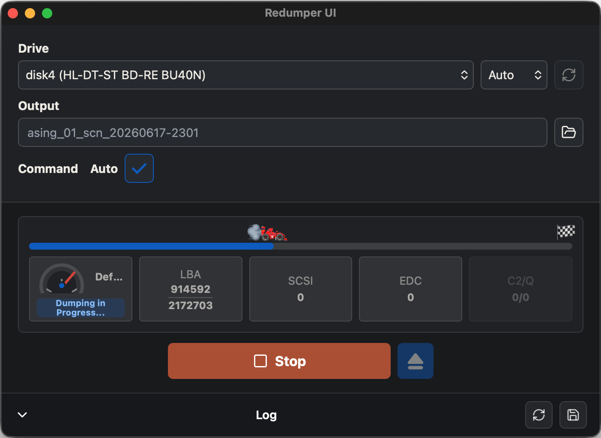
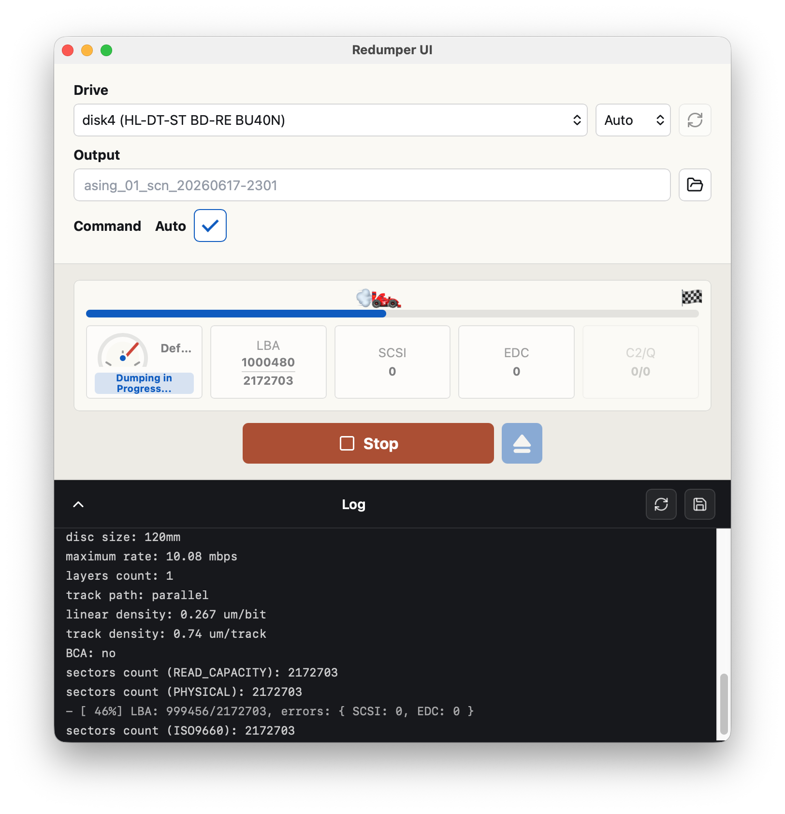

# Redumper UI

> **Project retired:** Redumper UI has been superseded by [Disc Xplorer's dumping capability](https://github.com/whatever-industries/disc-xplorer) and is no longer maintained. Use Disc Xplorer for continued disc dumping. This repository and its [final release, version 760](https://github.com/whatever-industries/redumper-ui/releases/tag/v760), are preserved for reference and community forks. No further updates or support are planned.

[](https://stand-with-ukraine.pp.ua)

Cross-platform desktop frontend for [`superg/redumper`](https://github.com/superg/redumper).

The app is built with Tauri v2, Rust, React, TypeScript, and Tailwind CSS. It
wraps the official redumper CLI with a typed command UI, streamed logs, and
platform-aware packaging.

## Screenshots





## Development

```sh
npm install
npm run prepare-redumper
npm run tauri:dev
```

`prepare-redumper` downloads the pinned upstream binary for the current target
into `src-tauri/resources/redumper/`. The downloaded binaries are intentionally
not tracked in git.

## Useful Commands

```sh
npm run dev
npm run build
npm run test
npm run typecheck
npm run update-upstream
```

## Final Release

[Version 760](https://github.com/whatever-industries/redumper-ui/releases/tag/v760)
is the final maintained release, bundling redumper b760. Downloads remain
available for Windows x64/ARM64, macOS x64/ARM64, and Linux x64/ARM64.
Automatic upstream checks and release builds have been disabled.

For continued development of the underlying CLI, see
[`superg/redumper`](https://github.com/superg/redumper).

## Licensing

This repository is GPL-compatible because release artifacts bundle upstream
redumper, which is GPL-3.0 licensed. See `NOTICE.md` for attribution.
